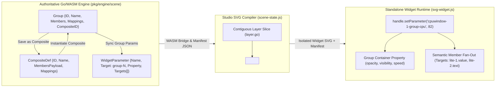

# SVG Animator Studio — Stage 16E: Comprehensive Architecture Review and Development Plan

- **Project:** SVG Animator Studio
- **Stage:** Stage 16E — Group-Level Data Inputs, Semantic Property Mappings & Custom Composite Objects
- **Document Status:** `Stage 16E — CORRECTIONS IMPLEMENTED, AWAITING USER ACCEPTANCE`
- **Implementation Authorisation:** `GRANTED & COMPLETED (M1 → M2 → M3 + Visual Acceptance Corrections)`
- **Planning Baseline Commit:** `bdf14fe`
- **M1 Implementation Commit:** `5b846b6` (`feat(stage16e-m1): group widget targets, multiplicative group speed, and LiteEffect clipboard support`)
- **M2 Implementation Commit:** `059f9c6` (`feat(stage16e-m2): group semantic property mappings, atomic multi-target fan-out, and batch precedence`)
- **M3 Implementation Commit:** `617b1ed` (`feat(stage16e-m3): reusable composite definitions, sequential placed instances, and composite showcase`)
- **Stage 16D-C Baseline Commit:** `5e1ac87` (`Stage 16D-C — CORRECTIONS IMPLEMENTED, AWAITING USER ACCEPTANCE`)
- **BookStack Reference:** Book `353` (`SVG-Animator Project Log`, Page `476`)

---

## 1. Executive Summary & Scope Boundaries

This document establishes the verified current development baseline of **SVG Animator Studio**, reconciles all repository and BookStack roadmap references for **Stage 16E**, inventories the current Go/WASM and JavaScript widget runtime architecture, and proposes a disciplined, phased engineering plan for **Stage 16E**.

### 1.1 Strict Scope Boundaries

1. **No Unapproved Production Code Changes:** This assignment is strictly limited to architectural investigation, roadmap reconciliation, and implementation planning. Zero production `.go`, `.js`, `.html`, or `.css` files are modified by this planning milestone.
2. **Accurate Stage 16D-C Status:** Stage 16D-C (`text-lite` T1–T4 and consolidated visual review corrections at commit `5e1ac87`) is recorded as **`CORRECTIONS IMPLEMENTED, AWAITING USER ACCEPTANCE`**. No premature final acceptance record is assumed or invented.
3. **Separation of Stage 16E vs. Future Digital Twin & Exploratory Concepts:**
   - **Stage 16E (Confirmed Scope):** Focuses on **SVG Animator Studio's** authoring, persistence, export, and `SVGWidget` runtime capabilities for **group-level widget property exposure**, **group-level semantic property mappings / multi-target fan-out**, **LiteEffect-complete group duplication and copy/paste**, and **reusable custom composite object definitions (templates) with independent placed instances**.
   - **Deferred to Future Digital Twin Stages:** The full Digital Twin host application, flattened raster background editor, live Proxmox/host telemetry ingestion services, and house-by-house scene construction remain outside Stage 16E.
   - **Explicitly Separated Exploratory Ideas:** Concepts such as a standard WebGUI data dictionary, export-time property remapping tables, interchangeable widget families, copyable theme directories, and fixed-dimension theme templates are documented in Section 2.3 as **exploratory future ideas** and are **not** silently pulled into Stage 16E.

---

## 2. Verified Current Development Baseline & Roadmap Reconciliation

### 2.1 Verified Current Development Baseline (15 Required Capability Areas)

Every capability area below has been verified directly against the current Git commit history (`git log`), Go engine source (`pkg/engine/`), frontend browser adapter (`internal/web/static/js/`), and BookStack Book `353` (`Pages 354–475`).

| # | Capability Area | Status Classification | Verified Commit & Source Evidence | Notes / Known Limitations |
| :--- | :--- | :--- | :--- | :--- |
| **1** | **Go/WASM Scene Engine, Selection, History, Groups, Layers & Persistence** | **Implemented and verified** | Stages 1–9, 12–15 (`v1.2.0`); `pkg/engine/scene/model.go`, `selection.go`, `history.go` (`maxDepth: 50`), `group.go`, `layer.go`, `pkg/engine/sva/`, `internal/db/sqlite.go` (`schema_json` `1.2.0`) | Go/WASM is the single authoritative owner of scene state, history, object naming, selection, flat single-level groups, unified layer stacking order, `.sva` ZIP packages, and SQLite persistence. |
| **2** | **Stage 16A–16C Widget Packaging, Manifests, Runtime API & Property Guides** | **Implemented and verified** | Stages 16A–16C (BookStack Pages `454–466`); `pkg/engine/scene/widget.go`, `internal/web/static/js/svg-widget.js` | Supports isolated widget SVG export (`<instanceId>__<id>`), embedded & standalone `widget-manifest.json`, `<name>-properties.md` guide generation, ZIP packaging, and `SVGWidget.mount()`, `setParameter()`, `setParameters()`, `getParameters()`, `resetParameters()`, `play()`, `pause()`, `stop()`, `setSpeed()`, `destroy()`. |
| **3** | **Stage 16D-A Visibility-Aware Runtime & Initial Lite Effects** | **Implemented and verified** | Commit `7e8d4f6` (*ACCEPTED*, BookStack Page `467`); `pkg/engine/scene/lite_effect.go`, `js/lite-effects.js`, `js/svg-widget.js` | `IntersectionObserver` + `prefers-reduced-motion` suspension (`sva-suspended`), plus `perimeter-tracer`, `pulse`, and `flash` low-load declarative effects. |
| **4** | **Permanent SVG Animation Test Lab & Engineering Guidance** | **Implemented and verified** | Commit `bf7ee3e` (*ACCEPTED*, BookStack Page `470`); `cmd/anim-test-lab/`, `pkg/animlab/`, `testlab/scenarios/`, `docs/architecture/svg-animation-engineering-guidance.md` | YAML-driven Chromium CDP benchmark harness (`M1–M6`) with empirical compositor/paint/CPU telemetry and architectural guardrails. |
| **5** | **Stage 16D-B Flow Lite (`flow-lite`)** | **Implemented and verified** | Commit `a3a7d24` (*ACCEPTED*, BookStack Page `471`); `pkg/engine/geometry/flow_geom.go`, `pkg/engine/scene/lite_effect.go`, `js/lite-effects.js` | Multi-point open path with straight and quadratic-Bézier curved sections (`bends[]`), `dashed`/`dotted`/`single` patterns, `tunnel`/`abrupt` endpoint modes, start/end delays, and Cycle Duration (`0.2..30.0 s`). |
| **6** | **Stage 16D-B Radar Ping Lite (`radar-lite`)** | **Implemented and verified** | Commit `ad814bb` (*ACCEPTED*, BookStack Page `471`); `pkg/engine/scene/lite_effect.go`, `js/lite-effects.js` | Filter-free expanding circular/elliptical outline pings (`single`, `multi` `1..6` staggered rings, `fading-ping`) with non-scaling stroke width and optional centre dot. |
| **7** | **Stage 16D-B Gauge / Level Lite (`gauge-lite`) with 4 Thresholds** | **Implemented and verified** | Commits `a086170` & `698e6cf` (*ACCEPTED*, BookStack Page `471`); `pkg/engine/scene/lite_effect.go`, `js/lite-effects.js`, `js/svg-widget.js` | Zero-idle-animation data-driven numeric indicators across 5 variants (`ring`, `hbar`, `vbar`, `segmented`, `level`), arbitrary negative/positive domains, valid `0.0`, 4 independently enabled threshold bands (`Thresholds []GaugeThresholdBand`), and runtime colour override precedence. |
| **8** | **Stage 16D-B Oscilloscope Lite (`oscilloscope-lite`)** | **Implemented and verified** | Commit `698e6cf` (*ACCEPTED*, BookStack Page `471`); `pkg/engine/scene/lite_effect.go`, `js/lite-effects.js`, `js/svg-widget.js` | 7 waveform presets (`ecg`, `sine`, `square`, `triangle`, `sawtooth`, `polyline`, `bezier`) across `static`, `animated` (2-tile periodic scroll), and `sampled` (`2..64` numeric samples) modes. |
| **9** | **Stage 16D-C Text & Typography (`text-lite` T1–T4 & Consolidated Corrections)** | **Implemented with known limitations** *(Corrections implemented, awaiting user acceptance)* | Commits `f07272f` (T1–T4) & `5e1ac87` (Consolidated corrections, BookStack Page `475`); `pkg/engine/scene/lite_effect.go`, `js/lite-effects.js`, `js/svg-widget.js`, `text-lite-demo.html` | Covers T1 containers/10 fonts/9-way alignment/rotation, T2 curved `<textPath>`, T3 horizontal/multiline-vertical/stacked-vertical tickers + 4 typewriter sequences + `TextLiteController` cycle-boundary `pendingText` handover, and T4 3-phase fade/blink (`lockOnOff`), `slide`, `blur-in`, `blur-out`, `scramble`, `once`/`loop`/`pingpong`. Status: **`CORRECTIONS IMPLEMENTED, AWAITING USER ACCEPTANCE`**. |
| **10** | **Browser Process Lifecycle & Cleanup Guidance** | **Implemented and verified** | Commit `84edf1d`; `pkg/animlab/session.go`, `pkg/animlab/session_test.go`, `docs/development/browser-process-lifecycle.md` | Enforces `animlab.AcquireBrowserSession` with unique `/tmp/sva-headless-chrome-*` profiles, bounded context timeouts, and deterministic remote process tree + crashpad cleanup on Kiwiberry (`192.168.100.40`). |
| **11** | **Object Grouping, Multi-Select, Alignment, Duplication & Layer Coalescing** | **Implemented with known limitations** | Stage 13 (`pkg/engine/scene/group.go`, `clipboard.go`, `layer.go`) | Flat single-level persistent `Group{ID, Name, Members, Metadata}` with contiguous layer coalescing (`coalesceGroupMembersInLayersLocked`) and group move/delete/rename. **Known Limitation Found:** `ClipboardPayload`, `CopySelection`, `PastePayload`, and `DuplicateSelection` in `pkg/engine/scene/clipboard.go` currently copy/remap `Nodes`, `Flows`, `Glows`, `Ripples`, `Images`, and `Groups`, **but omit `LiteEffects` (`SelectionLite`) and `WidgetParameters`**! |
| **12** | **Group-Level Widget Properties (`group.opacity`, `group.visibility`)** | **Partially implemented** | `pkg/engine/scene/widget.go` (`ObjectPropertyCatalog["group"]` at line 466; `InferTargetType` at line 656); `js/app.js` (`fallbackCatalog.group` at line 2659) | `ObjectPropertyCatalog["group"]` defines `opacity` and `visibility`, **but**: (a) `getObjectNameForTargetLocked` (`widget.go:528`) omits `s.groups`; (b) `ValidateWidgetExport` (`widget.go:874`) does not check `s.groups` and fails target resolution because `buildFullSVG` (`scene-state.js:413`) does not emit a `<g id="group-1" data-group-id="group-1">` DOM wrapper or `data-group-id` member attributes; and (c) `renderWidgetParametersOverview` (`app.js:3337`) hides the Right Drawer widget authoring deck when `sel.type === 'group'`. |
| **13** | **Group-Level Semantic Property Mappings & Multi-Target Fan-Out** | **Planned but not implemented** | Reserved for Stage 16E in `AGENTS.md` (line 103), `docs/stage16d-b-proposed-implementation-plan.md` (Section C.1), and BookStack Pages `471` & `475` | Allowing a Group to expose named group-level inputs/aliases (e.g., `<group-name>-group-<alias>`) that fan out or delegate to one or more member object properties (`node`, `flow`, `glow`, `ripple`, `image`, `lite`). Scheduled for **Stage 16E**. |
| **14** | **Custom Composite Objects (Reusable Definitions & Independent Placed Instances)** | **Planned but not implemented** | Reserved for Stage 16E in `AGENTS.md` (line 103), BookStack Page `352` (*Reusable Component Libraries & Sub-Assemblies*), and Pages `471` & `475` | Saving a configured Group (members + internal flows + LiteEffects + group property mappings) as a reusable Composite Definition (`CompositeDef`) and placing multiple independent Group instances (`cpuwindow-1`, `cpuwindow-2`, etc.) on the canvas with collision-free parameter bindings. Scheduled for **Stage 16E**. |
| **15** | **Full Digital Twin Presenter Application, Flattened Raster Background Editor, Live Telemetry Ingestion & Exploratory WebGUI Dictionary / Theme Concepts** | **Not part of the current roadmap** *(for Stage 16E)* | `docs/stage16d-b-proposed-implementation-plan.md` (Section C.1); BookStack Book `468` (`Digital Twin`) | Belongs to the separate Digital Twin application (`Book 468`) or unapproved exploratory discussions. Must not be pulled into Stage 16E. |

---

### 2.2 Roadmap Reconciliation & Authoritative Stage 16E Scope

Across all authoritative project records, Stage 16E is consistently defined:

1. **`AGENTS.md` (Section 2, line 103):**
   > *"Future roadmap items (e.g. Stage 16E group-level data inputs and custom composite objects, or Digital Twin presenter workflows) are planned extensions and must not be implemented until their specific phases are approved."*
2. **Stage 16D-B Plan (`docs/stage16d-b-proposed-implementation-plan.md`, Section C.1, line 55 & BookStack Page `471`):**
   > *"Reserved for Stage 16E and Later Stages: Group-level data inputs, group property aliases, and custom composite objects (Stage 16E); canvas and background image fitting modes (future canvas stage); and Digital Twin flattened raster background workflows, shared animation definition aliases such as `cpuwindow`, and large-scale telemetry mapping services (future Digital Twin stages)."*
3. **Stage 16D-C Plan (`docs/stage16d-c-text-and-typography-plan.md`, Section 2.3, line 82 & BookStack Page `475`):**
   > *"Group-level data inputs, group property aliases, and custom composite objects (`Stage 16E`)."*
4. **Stage 16B Widget Architecture Record (BookStack Page `459`):**
   > Defined `group` in `ObjectPropertyCatalog` with `opacity` and `visibility` alongside `node`, `flow`, `glow`, `ripple`, `image`, and `lite`, establishing the catalog slot for group-level external controls.
5. **Early Product Roadmap (`Book 193`, Page `352` — *SVG Animator Studio: Roadmap & Future Features*):**
   > Envisioned *"Reusable Component Libraries & Sub-Assemblies: Provides a local asset drawer to save and drop pre-built multi-node architecture templates... Serializes node clusters and their connecting data flows into reusable JSON templates"*.

#### Roadmap Discrepancies Identified & Recommended Resolutions

| Discrepancy | Root Cause | Recommended Resolution for Stage 16E |
| :--- | :--- | :--- |
| **1. `ObjectPropertyCatalog["group"]` exists in Go (`widget.go:466`), but Group widget parameters cannot be authored in Studio or resolved in exported SVG** | Stage 16B added `"group"` to `ObjectPropertyCatalog` and `InferTargetType`, but `buildFullSVG` renders group members flat without a `<g id="group-1">` wrapper, `getObjectNameForTargetLocked` omits `s.groups`, and `app.js` excludes `'group'` from the Right Drawer authoring deck. | Complete end-to-end group target resolution in **Stage 16E-M1**: wire `s.groups` into `getObjectNameForTargetLocked` and `ValidateWidgetExport`, emit `<g id="group-1" class="scene-group" data-group-id="group-1" data-semantic-target="group-1">` around contiguous group members in `buildFullSVG`, and enable `'group'` in the Right Drawer and Floating Inspector. |
| **2. `DuplicateSelection` and `CopySelection`/`PastePayload` (`clipboard.go`) omit `LiteEffects` (`SelectionLite`) and `WidgetParameters`** | `clipboard.go` was implemented in Stage 13 before `LiteEffect` (`Stage 16D-A/B/C`) and `WidgetParameter` (`Stage 16B/C`) existed. | Resolve in **Stage 16E-M1/M3**: extend `ClipboardPayload`, `CopySelection`, `PastePayload`, and `DuplicateSelection` in `pkg/engine/scene/clipboard.go` to copy and remap `LiteEffects []LiteEffect` (including `SelectionLite` group members) and clone group-level widget parameters/mappings with remapped target IDs and derived parameter names. |
| **3. Shared composite definition (`cpuwindow`) vs. placed instance identity (`cpuwindow-1`, `cpuwindow-2`)** | Early notes mentioned shared definition aliases like `cpuwindow`, whereas Stage 16C requires every runtime widget parameter on a mounted SVG canvas to address a specific placed instance without colliding. | Resolve cleanly in **Stage 16E-M3**: a **Composite Definition** (e.g., template `cpuwindow`) defines the reusable blueprint (member objects, relative layout, internal flows, and exposed group property mappings), while each **Placed Composite Instance** is a concrete `Group` in the scene (`cpuwindow-1`, `cpuwindow-2`) with its own unique member IDs, `sourceCompositeId: "comp-1"` metadata link, and collision-free runtime parameters (`cpuwindow-1-group-cpu`, `cpuwindow-2-group-cpu`). |

---

### 2.3 Separation of Confirmed Stage 16E Scope vs. Exploratory Future Ideas

| Category | Included in Stage 16E? | Scope & Disposition |
| :--- | :---: | :--- |
| **A. Group-Level Container Widget Properties (`opacity`, `visibility`, `speed`) & SVG `<g class="scene-group">` Emission** | **YES (Confirmed)** | Every persistent `Group` emits a contiguous `<g id="group-N" class="scene-group" data-group-id="group-N" data-semantic-target="group-N">` wrapper in `buildFullSVG` and supports group-wide `opacity`, `visibility`, and `speed` (playback rate multiplier across all member animations) in Go and `svg-widget.js`. |
| **B. Group-Level Semantic Property Mappings (1-to-1 Delegation & 1-to-Many Fan-Out)** | **YES (Confirmed)** | A `Group` can define named **Group Property Mappings** (e.g., `cpu`, `statusColor`, `alertText`, `flowRate`) exposed as widget parameters (`<group-name>-group-<alias>`) that validate and fan out at runtime to one or more member object properties (`lite-1.value`, `lite-2.text`, `node-1.stroke`, `glow-1.color`, etc.). |
| **C. LiteEffect-Complete Group Copy/Paste, Duplication & Parameter Remapping** | **YES (Confirmed)** | `CopySelection`, `PastePayload`, and `DuplicateSelection` copy all `SelectionLite` (`perimeter-tracer`, `pulse`, `flash`, `flow-lite`, `radar-lite`, `gauge-lite`, `oscilloscope-lite`, `text-lite`) members alongside `Node`, `Flow`, `Glow`, `Ripple`, and `Image` members, and clone the group's exposed widget parameters/mappings onto the new group instance. |
| **D. Custom Composite Objects (Reusable Composite Definitions & Independent Placed Instances)** | **YES (Confirmed)** | Any configured `Group` (with its member objects and group property mappings) can be saved as a reusable **Composite Definition (`CompositeDef`)** in the scene / Studio library and stamped onto the canvas multiple times as independent placed group instances (`cpuwindow-1`, `cpuwindow-2`) with auto-generated instance parameters. |
| **E. Digital Twin Flattened Raster Background Workflow Compatibility** | **COMPATIBILITY ONLY** | Stage 16E ensures composite groups and their runtime parameters render and animate identically over any Studio background (including a baked/flattened raster background image via Stage 15's existing `BakeImage`), without pulling Digital Twin host services into SVG Animator Studio. |
| **F. Standard WebGUI Data Dictionary & Export-Time Property Remapping Tables** | **NO (Exploratory Future Idea)** | Keeping SVG Animator Studio decoupled from any single external consumer's schema dictionary preserves its general-purpose widget architecture. External consumers (Sentinel-PVE, Digital Twin) map their own telemetry keys to manifest parameter names (`<object-name>-<type>-<property>`) or group semantic parameter names (`<group-name>-group-<alias>`). |
| **G. Interchangeable Widget Families, Copyable Theme Directories & Fixed-Dimension Theme Templates** | **NO (Exploratory Future Idea)** | Host-side theme packaging, filesystem theme directory swapping, and fixed-dimension theme contracts belong to external presenter/dashboard host applications, not the core SVG Animator Studio scene engine. |

---

## 3. Architecture Inventory of Relevant Subsystems

### 3.1 Authoritative Go Scene & Group Model (`pkg/engine/scene/`)

- **[model.go](file:///root/projects/svg-animator/pkg/engine/scene/model.go#L549-L569):** `Snapshot` holds `Nodes`, `Flows`, `Glows`, `Ripples`, `LiteEffects`, `Groups`, `Images`, `Layers`, and `Parameters []WidgetParameter`.
- **[group.go](file:///root/projects/svg-animator/pkg/engine/scene/group.go#L11-L26):**
  ```go
  type GroupMember struct {
      Type SelectionType `json:"type"` // "node", "flow", "glow", "ripple", "image", "lite"
      ID   StringID      `json:"id"`
  }

  type Group struct {
      ID       StringID       `json:"id"`
      Name     string         `json:"name"`
      Members  []GroupMember  `json:"members"`
      Metadata map[string]any `json:"metadata,omitempty"`
  }
  ```
  - Enforces a **flat, single-level hierarchy** (`CreateGroup` at [group.go:126](file:///root/projects/svg-animator/pkg/engine/scene/group.go#L126) rejects `SelectionGroup` members, and [group.go:136](file:///root/projects/svg-animator/pkg/engine/scene/group.go#L136) ensures each object belongs to at most one group).
  - Supports `CreateGroup`, `Ungroup`, `DeleteGroup`, `MoveGroup` (translating both percentage-coordinate objects and pixel-coordinate `LiteEffect` objects at [group.go:460-520](file:///root/projects/svg-animator/pkg/engine/scene/group.go#L460-L520)), `ComputeGroupBounds`, and `PruneMemberFromGroupsLocked` (auto-dissolving groups that drop below 2 members at [group.go:636](file:///root/projects/svg-animator/pkg/engine/scene/group.go#L636)).
- **[layer.go](file:///root/projects/svg-animator/pkg/engine/scene/layer.go#L164-L209):**
  - `coalesceGroupMembersInLayersLocked(grp Group)` **guarantees** that all members of any `Group` occupy a single contiguous slice inside `s.layers` (`[]LayerEntry`), preserving their relative internal z-order while preventing non-member objects from interleaving between members of the same group.
  - `resolveTargetLayerKeys` ([layer.go:283-334](file:///root/projects/svg-animator/pkg/engine/scene/layer.go#L283-L334)) expands `SelectionGroup` into its constituent member keys so `BringToFront`, `BringForward`, `SendBackward`, and `SendToBack` move the entire group as a contiguous block.

### 3.2 Authoritative Go Widget Parameter & Manifest Engine (`pkg/engine/scene/widget.go`)

- **[widget.go](file:///root/projects/svg-animator/pkg/engine/scene/widget.go#L25-L38):**
  ```go
  type WidgetParameter struct {
      Name        string   `json:"name"`
      Type        string   `json:"type"`               // "color", "number", "speed", "boolean", "text", "enum"
      Target      string   `json:"target,omitempty"`   // e.g. "node-1", "flow-2", "lite-1", "group-1", "root"
      Property    string   `json:"property,omitempty"` // e.g. "fill", "stroke", "opacity", "speed", "visibility", "text"
      Default     any      `json:"default,omitempty"`
      Min         *float64 `json:"min,omitempty"`
      Max         *float64 `json:"max,omitempty"`
      Step        *float64 `json:"step,omitempty"`
      Options     []string `json:"options,omitempty"`
      Description string   `json:"description,omitempty"`
  }
  ```
- **Deterministic Parameter Naming ([widget.go:678-702](file:///root/projects/svg-animator/pkg/engine/scene/widget.go#L678-L702)):**
  - `GenerateDerivedParameterName(objectName, property, targetType)` produces `<slugified-object-name>-<target-type>-<property>` (e.g., `cpu-gauge-lite-value`, `alert-banner-lite-text`, or for a group `cpuwindow-1-group-opacity`).
- **Auto-Rename Synchronization ([widget.go:706-749](file:///root/projects/svg-animator/pkg/engine/scene/widget.go#L706-L749)):**
  - `syncWidgetParamsOnRenameLocked(targetID, oldName, newName)` automatically rewrites derived parameter names when an object is renamed. Currently called by `RenameObject` (`selection.go`), **and should also be called by `RenameGroup` ([group.go:258](file:///root/projects/svg-animator/pkg/engine/scene/group.go#L258))**.

### 3.3 Frontend SVG Compilation (`scene-state.js`) & Widget Runtime (`svg-widget.js`)

- **[scene-state.js](file:///root/projects/svg-animator/internal/web/static/js/scene-state.js#L378-L540) (`buildFullSVG`):**
  - Iterates `window.LayerManager.getLayers()` in bottom-to-top order and invokes `renderNodeElement`, `renderFlowElement`, `renderGlowElement`, `renderRippleElement`, `renderLiteElement`, and `renderImageElement`.
  - Because `coalesceGroupMembersInLayersLocked` already keeps each group's members contiguous in `layers`, `buildFullSVG` can open a `<g id="group-N" class="scene-group" data-group-id="group-N" data-semantic-target="group-N" data-semantic-name="...">` tag when entering a group's contiguous member run and close `</g>` when leaving it, without altering visual stacking order.
- **[svg-widget.js](file:///root/projects/svg-animator/internal/web/static/js/svg-widget.js#L109-L253) (`isolateSVGString`) & [svg-widget.js:2470-2509](file:///root/projects/svg-animator/internal/web/static/js/svg-widget.js#L2470-L2509) (`setParameters`):**
  - Scopes all `id="..."` attributes into `idMap` (`<instanceId>__<authoredId>`) and preserves `data-semantic-target`, `data-node-id`, `data-lite-id`, and (in Stage 16E) `data-group-id`.
  - Performs two-phase atomic parameter updates: Phase 1 validates all parameter names, value constraints, and target element resolution; Phase 2 mutates the DOM and emits `change` / `parametersChanged`.

---

## 4. Reusable Components vs. Required New Capabilities

### 4.1 Existing Mechanisms to Reuse Without Reinvention

1. **Contiguous Layer Coalescing (`coalesceGroupMembersInLayersLocked` in `layer.go`):** Already guarantees group members are contiguous in `s.layers`, making `<g class="scene-group" data-group-id="group-N">` wrapper emission in `buildFullSVG` clean and z-order-safe.
2. **Three-Tier Parameter Naming & Auto-Rename (`GenerateDerivedParameterName` & `syncWidgetParamsOnRenameLocked` in `widget.go`):** Naturally produces `<group-name>-group-<property-or-alias>` and updates parameter names when a group is renamed.
3. **Subtree Animation Speed & Visibility Controls in `svg-widget.js`:** `applyTargetedSpeed(el, localRate, masterRate)` ([svg-widget.js:421-472](file:///root/projects/svg-animator/internal/web/static/js/svg-widget.js#L421-L472)) already queries `el.getAnimations({ subtree: true })`, `el.querySelectorAll('animate, animateMotion, animateTransform')`, and `el.querySelectorAll('.lite-payload')`. When `el` is `<g id="group-1" class="scene-group">`, `applyTargetedSpeed`, `opacity`, and `visibility` work across the entire group subtree automatically!
4. **Atomic Two-Phase `setParameters(batch)` in `svg-widget.js`:** Easily extends from a single `targetEl` per parameter to an array of resolved `targetBindings` (`[{ targetEl, property, childParamDef }]`) so a group-level semantic parameter atomically validates and fans out to multiple member elements.
5. **Dual-Unit Group Translation (`MoveGroup` in `group.go`):** Already translates both percentage-based objects (`node`, `flow`, `glow`, `ripple`, `image`, `flow-lite` waypoints) and pixel-based `LiteEffect` objects (`X += (dxPct / 100.0) * canvasW`).

---

## 5. Proposed Stage 16E Technical Design

### 5.1 Architecture Overview Diagram



### 5.2 Group-Level Container Properties & SVG `<g class="scene-group">` Emission

1. **Contiguous Group `<g>` Wrapper in `buildFullSVG` (`scene-state.js`):**
   - Because `coalesceGroupMembersInLayersLocked` guarantees all members of `group-N` are contiguous in `s.layers`, `buildFullSVG` tracks `currentGroupId` while iterating `layers`.
   - When `memberGroup` changes from `null` (or a previous group) to `grp`, `buildFullSVG` opens:
     ```xml
     <g id="group-1" class="scene-group" data-group-id="group-1" data-semantic-target="group-1" data-semantic-name="cpuwindow-1">
     ```
   - When the contiguous run of `group-1` members ends, `buildFullSVG` closes `</g>`.
2. **Built-In Group Container Properties (`ObjectPropertyCatalog["group"]`):**
   - `opacity` (`number`, `0.0..1.0`, default `1.0`): Sets `opacity` on the `<g class="scene-group">` wrapper, scaling the combined opacity of all member objects uniformly.
   - `visibility` (`boolean`, default `true`): Toggles `display: none` / `visibility: hidden` on the `<g class="scene-group">` wrapper.
   - `speed` (`speed`, `0.1..10.0`, default `1.0`): Calls `applyTargetedSpeed(groupEl, val, masterSpeed)` on the `<g class="scene-group">` wrapper, scaling all CSS `.lite-payload`, Web Animations, and SMIL `<animate*>` elements inside the group subtree.

### 5.3 Group-Level Semantic Property Mappings & Multi-Target Fan-Out

Beyond container-wide `opacity`, `visibility`, and `speed`, a composite group (such as a server telemetry card or `cpuwindow` panel) needs **semantic group-level data inputs** that route to specific member properties (1-to-1 delegation) or multiple member properties simultaneously (1-to-many fan-out).

#### Go Data Structures (`pkg/engine/scene/group.go` & `widget.go`)

```go
// GroupTargetBinding identifies a member object and property driven by a group-level parameter.
type GroupTargetBinding struct {
    MemberType SelectionType `json:"memberType"` // "node", "flow", "glow", "ripple", "image", "lite"
    MemberID   StringID      `json:"memberId"`   // e.g. "1", "image-1"
    Target     string        `json:"target"`     // canonical target ID, e.g. "lite-1", "node-2"
    Property   string        `json:"property"`   // e.g. "value", "color", "text", "speed", "samples"
}

// GroupPropertyMapping defines a named semantic input on a Group that routes to 1..N member properties.
type GroupPropertyMapping struct {
    Alias       string               `json:"alias"`                 // slugified semantic key, e.g. "cpu", "status-color", "headline"
    Label       string               `json:"label,omitempty"`       // human-readable label, e.g. "CPU Load (%)"
    Type        string               `json:"type"`                  // "number", "color", "text", "boolean", "speed", "enum"
    Default     any                  `json:"default,omitempty"`
    Min         *float64             `json:"min,omitempty"`
    Max         *float64             `json:"max,omitempty"`
    Step        *float64             `json:"step,omitempty"`
    Options     []string             `json:"options,omitempty"`
    Description string               `json:"description,omitempty"`
    Targets     []GroupTargetBinding `json:"targets"`               // 1..N member bindings within this group
}
```

And on `WidgetParameter` (`pkg/engine/scene/widget.go`):
```go
type WidgetTargetBinding struct {
    Target   string `json:"target"`   // e.g. "lite-1"
    Property string `json:"property"` // e.g. "value"
}
```
`WidgetParameter` gains an optional field:
```go
Targets []WidgetTargetBinding `json:"targets,omitempty"`
```

#### Naming, Type Compatibility & Precedence Rules

1. **Canonical Parameter Naming:**
   - A group named `cpuwindow-1` with a semantic mapping alias `cpu` generates the widget parameter name:
     `cpuwindow-1-group-cpu` (via `GenerateDerivedParameterName(group.Name, mapping.Alias, "group")`).
   - Built-in container properties on the same group generate:
     `cpuwindow-1-group-opacity`, `cpuwindow-1-group-visibility`, `cpuwindow-1-group-speed`.
   - Reserved built-in group property names (`opacity`, `visibility`, `speed`) cannot be used as custom mapping aliases.
2. **Strict Type & Domain Validation in Go:**
   - Every `GroupTargetBinding` in `mapping.Targets` must reference an object that is currently a member of `group.Members`.
   - The first bound member property establishes the default `Type`, `Default`, `Min`, `Max`, and `Options` from `ObjectPropertyCatalog` (for example, binding to `gauge-lite.value` sets `type: "number"`, `default: 65`, `min: 0`, `max: 100`).
   - Additional fan-out targets added to the same mapping must have a compatible parameter type:
     - Exact type match (e.g. `color` → `node.stroke` + `glow.color` + `lite.color`), OR
     - `number` → `text` coercion (allowing a numeric metric like `cpu = 82` to simultaneously drive `gauge-lite.value` as a number and `text-lite.text` as `"82"`!).
3. **Runtime Application & Precedence in `svg-widget.js`:**
   - In `setParameters(batch)`, if `paramDef.targets` is non-empty (`Array.isArray(paramDef.targets) && paramDef.targets.length > 0`), Phase 1 resolves every `b.target` in `paramDef.targets` via `resolveTargetElement(svgEl, details.idMap, b.target)`. If any bound target is missing, Phase 1 throws an atomic error before any DOM mutation occurs.
   - In Phase 2, `setParameters` iterates all resolved `targetBindings` in deterministic order and calls `applyPropertyToElement(b.targetEl, b.property, coercedVal, b.childParamDef, handle, isInit)`.
   - **Precedence Rule:** Within a single `setParameters(batch)` call, direct member parameters (if any are also exposed) are applied after group-level parameters, or if called separately via `setParameter()`, standard **last-write-wins** applies. For `gauge-lite`, setting a group parameter mapped to `gauge-lite.value` evaluates the 4 threshold bands normally unless a parameter mapped to `gauge-lite.color` explicitly activates the application colour override.

### 5.4 Lifecycle Integrity on Rename, Member Removal, Delete & Ungroup

| Lifecycle Event | Authoritative Go Engine Behaviour (`pkg/engine/scene/`) |
| :--- | :--- |
| **Group Renamed (`RenameGroup`)** | Calls `syncWidgetParamsOnRenameLocked("group-N", oldGroupName, newGroupName)` so both container parameters (`<old>-group-opacity`) and semantic mapping parameters (`<old>-group-cpu`) automatically rename to `<new>-group-opacity` and `<new>-group-cpu`. |
| **Member Removed from Scene (`DeleteNode`, `DeleteLiteEffect`, etc.)** | `PruneMemberFromGroupsLocked(selType, id)` removes the member from `grp.Members` and also prunes any `GroupTargetBinding` referencing `(selType, id)` from `grp.Mappings`. If a `GroupPropertyMapping` loses all of its `Targets`, that mapping and its corresponding `WidgetParameter` are automatically removed. If `len(grp.Members) < 2`, the group dissolves and its `"group-N"` widget parameters are removed. |
| **Group Ungrouped (`Ungroup`)** | Dissolves `group-N` and removes all `WidgetParameter` entries whose `Target == "group-N"`, while leaving all member objects and any member-direct widget parameters intact. |
| **Group Deleted (`DeleteGroup`)** | Deletes all member objects, removes their member-direct widget parameters, deletes `group-N`, and removes all `"group-N"` widget parameters in a single atomic scene revision. |

### 5.5 Custom Composite Objects: Shared Definition vs. Independent Placed Instances

To support workflows like designing a `cpuwindow` telemetry module once (combining a container shape/image, a 4-threshold `gauge-lite`, an `oscilloscope-lite` sparkline, a `text-lite` title/readout, and a `perimeter-tracer` alert border) and placing multiple independent instances on the canvas:

1. **Authoritative `CompositeDef` Model in Go (`pkg/engine/scene/composite.go`):**
   ```go
   type CompositeDef struct {
       ID          StringID               `json:"id"`                    // e.g. "comp-1"
       Name        string                 `json:"name"`                  // e.g. "cpuwindow"
       Description string                 `json:"description,omitempty"`
       WidthPct    float64                `json:"widthPct"`              // bounding box width in canvas %
       HeightPct   float64                `json:"heightPct"`             // bounding box height in canvas %
       Payload     ClipboardPayload       `json:"payload"`               // self-contained relative member objects (Nodes, Flows, Glows, Ripples, Images, LiteEffects)
       Mappings    []GroupPropertyMapping `json:"mappings,omitempty"`    // template group-level semantic property mappings
   }
   ```
2. **Saving a Group as a Composite Definition (`Composite.SaveFromGroup`):**
   - Takes an existing `groupID` and a template name (defaulting to `group.Name`, e.g., `"cpuwindow"`).
   - Extracts all members of the group (including `Nodes`, `Flows`, `Glows`, `Ripples`, `Images`, and `LiteEffects`) into `CompositeDef.Payload` and clones `group.Mappings` into `CompositeDef.Mappings`.
   - Stores `CompositeDef` in `Scene.composites` (persisted in `Snapshot`, `.sva` `scene.json`, and SQLite `schema_json` `1.2.0` under `composites: []`).
3. **Placing an Independent Composite Instance (`Composite.Instantiate`):**
   - Given `compositeID` and a target canvas position `(centerX, centerY)` (or default offset):
   - Allocates a collision-free instance name using a sequential suffix derived from `CompositeDef.Name`: e.g., `cpuwindow-1`, `cpuwindow-2`, `cpuwindow-3`.
   - Instantiates fresh copies of all member objects from `CompositeDef.Payload` with new unique IDs (`nodeIDMap`, `flowIDMap`, `glowIDMap`, `rippleIDMap`, `imageIDMap`, `liteIDMap`), translated so the composite's bounding box centre lands at `(centerX, centerY)`.
   - Creates a new persistent `Group` (`group-N`, `Name: "cpuwindow-1"`, `CompositeID: "comp-1"`).
   - Remaps `CompositeDef.Mappings` onto the new group's member IDs and auto-generates the group's exposed `WidgetParameter` entries:
     - Instance 1: `cpuwindow-1-group-cpu`, `cpuwindow-1-group-history`, `cpuwindow-1-group-label`, `cpuwindow-1-group-status`
     - Instance 2: `cpuwindow-2-group-cpu`, `cpuwindow-2-group-history`, `cpuwindow-2-group-label`, `cpuwindow-2-group-status`
4. **Independence vs. Optional Definition Update:**
   - Once placed on the canvas, each instance (`cpuwindow-1`, `cpuwindow-2`) is a standard, self-contained `Group` whose position, size, or member properties can be inspected, moved, duplicated, or ungrouped without fragile hidden live-mutation side effects.
   - Recording `CompositeID: "comp-1"` on `Group` provides provenance metadata in the inspector (`Composite: cpuwindow`) without locking the user out of per-instance adjustments.

### 5.6 Why Coordinate-System Heterogeneity Precludes Arbitrary Group 2D Affine Rotation/Scale in Stage 16E

A critical architectural finding from inspecting `pkg/engine/scene/group.go` ([lines 385-527](file:///root/projects/svg-animator/pkg/engine/scene/group.go#L385-L527)) is that SVG Animator Studio uses **two distinct coordinate spaces** across scene object types:
- **Canvas Percentage Coordinates (`0..100%` of `canvasW × canvasH`):** Used by `Node` (`X, Y`), `Flow` (`Nodes []Point`), `Glow` (`X, Y`), `Ripple` (`X, Y`), `Image` (`X, Y`), and `flow-lite` (`Points []Point`).
- **Canvas Pixel Coordinates (`0..canvasW`, `0..canvasH` in SVG user units):** Used by `LiteEffect` (`perimeter-tracer`, `pulse`, `flash`, `radar-lite`, `gauge-lite`, `oscilloscope-lite`, `text-lite` `X, Y, Width, Height, Radius`).

Translation (`MoveGroup(id, dxPct, dyPct)`) converts cleanly between percentage and pixel spaces (`dxPx = (dxPct / 100.0) * canvasW`). However, applying a group-level CSS/SVG `transform="rotate(...) scale(...)"` on `<g class="scene-group">` would:
1. Shift the transform origin relative to percentage-positioned vs. pixel-positioned children whenever the canvas aspect ratio changes;
2. Desynchronize stage overlay handles (`#nodeSelectionOverlay`, `#liteSelectionOverlay`, flow waypoint handles) which compute hit boxes from Go scene coordinates (`ComputeGroupBounds`); and
3. Interfere with child CSS `@keyframes` that use `transform` (`pulse`, `radar-lite`, `oscilloscope-lite`, `text-lite` tickers).

Therefore, **Stage 16E explicitly supports group-level translation (`MoveGroup`), group-level container properties (`opacity`, `visibility`, `speed`), and group-level semantic property mappings**, while individual member rotation/sizing remains authored on the member objects.

---

## 6. Staged Milestone Breakdown (`Stage 16E-M1` – `Stage 16E-M3`)

Stage 16E is structured into **three focused engineering milestones** (`M1`, `M2`, `M3`).

---

### Milestone 1 (`Stage 16E-M1`): Group Widget Target Resolution, Container Properties & LiteEffect-Complete Group Clipboard

- **Purpose:** Make persistent `Group` objects first-class widget targets in Go, SVG generation, Studio inspectors, and `svg-widget.js`, and fix `clipboard.go` so copying, pasting, and duplicating a group preserves all `LiteEffect` (`SelectionLite`) members.
- **Exact User-Visible Capability:**
  - Selecting a Group on the canvas or in the Layers drawer enables the **Right Drawer Widget Parameters Authoring Deck** and **Floating Context Inspector Widget Section** for the group (`GROUP`).
  - Users can rename the group and expose group-level **`Group Opacity (0..1)`**, **`Visibility (Toggle)`**, and **`Group Animation Speed (0.1..10x)`** as external widget parameters (`<group-name>-group-opacity`, `<group-name>-group-visibility`, `<group-name>-group-speed`).
  - Exported SVGs wrap contiguous group members in `<g id="group-N" class="scene-group" data-group-id="group-N" data-semantic-target="group-N" data-semantic-name="...">`.
  - Calling `widget.setParameter('<group-name>-group-opacity', 0.4)`, `setParameter('<group-name>-group-visibility', false)`, or `setParameter('<group-name>-group-speed', 2.5)` controls the entire group atomically at runtime.
  - Duplicating (`Ctrl+D` / `Duplicate Group`) or copying/pasting (`Ctrl+C` / `Ctrl+V`) a group containing any `LiteEffect` (`perimeter-tracer`, `pulse`, `flash`, `flow-lite`, `radar-lite`, `gauge-lite`, `oscilloscope-lite`, `text-lite`) copies and translates all `LiteEffect` members accurately alongside `Node`, `Flow`, `Glow`, `Ripple`, and `Image` members.
- **Architecture & Data Model Changes:**
  - `pkg/engine/scene/widget.go`:
    - Add `"speed"` (`Group Animation Speed`, `0.1..10.0`, default `1.0`) to `ObjectPropertyCatalog["group"]`.
    - Add `s.groups` lookup to `getObjectNameForTargetLocked` and `ValidateWidgetExport`.
    - Call `s.syncWidgetParamsOnRenameLocked("group-"+string(id), oldName, name)` inside `RenameGroup` (`group.go`) and remove `"group-"+string(id)` widget parameters on `Ungroup` and `DeleteGroup`.
  - `pkg/engine/scene/clipboard.go`:
    - Add `LiteEffects []LiteEffect` to `ClipboardPayload`.
    - Extend `CopySelection` and `PastePayload` to copy, offset (both pixel `X, Y` for box LiteEffects and percentage `Points[]` for `flow-lite`), and remap `SelectionLite` members in `Groups`.
  - `internal/web/static/js/scene-state.js` (`buildFullSVG`):
    - Emit `<g id="group-N" class="scene-group" data-group-id="group-N" data-semantic-target="group-N" data-semantic-name="...">` around contiguous group member layers.
  - `internal/web/static/js/svg-widget.js`:
    - Extend `resolveTargetElement` to match `[data-group-id="${targetName}"]`.
    - Verify `applyPropertyToElement` applies `opacity`, `visibility`, and `speed` (`applyTargetedSpeed`) to `<g class="scene-group">`.
  - `internal/web/static/js/app.js` & `context-editor.js`:
    - Include `'group'` in `renderWidgetParametersOverview`, `renderWidgetPropertyCards`, `getObjectPropValue`, and `#drawerWidgetObjRenameInput`.
- **Existing Mechanisms Reused:** `coalesceGroupMembersInLayersLocked`, `ObjectPropertyCatalog["group"]`, `applyTargetedSpeed`, `MoveGroup` dual-unit coordinate math.
- **Persistence & Export Behaviour:** Backward-compatible with `Snapshot`, `.sva`, and SQLite `schema_json` `1.2.0`; `ValidateWidgetExport` verifies `<g data-group-id="group-N">` resolution.
- **Automated & Browser Tests:**
  - Go unit tests in `pkg/engine/scene/group_test.go` and `widget_test.go` verifying group widget parameter exposure, rename synchronization, ungroup/delete cleanup, `ValidateWidgetExport` pass/fail, and `DuplicateSelection` with `LiteEffect` members.
  - Node regression harness (`scripts/regression-harness.js`) verifying `SVGWidget.mount()` and `setParameter()` for group `opacity`, `visibility`, and `speed`.
- **Regression Risks:** Must ensure `<g class="scene-group">` emission in `buildFullSVG` only wraps contiguous members when `LayerManager` is active and does not break single-object hit testing on the Studio stage.
- **Explicit Exclusions:** No nested groups; no group-level 2D rotation/scale transform matrices.

---

### Milestone 2 (`Stage 16E-M2`): Group-Level Semantic Property Mappings & Multi-Target Fan-Out

- **Purpose:** Enable a Group to expose custom semantic data inputs (aliases such as `cpu`, `statusColor`, `headline`, `samples`) that delegate to a specific member property (1-to-1) or fan out to multiple compatible member properties (1-to-many) within the group.
- **Exact User-Visible Capability:**
  - When a Group is selected, the Right Drawer Widget Authoring Deck and Floating Group Inspector display a **"Group Semantic Property Mappings"** section below the built-in group container properties (`opacity`, `visibility`, `speed`).
  - Users can click **"+ Add Group Input Mapping"**, enter a semantic alias (e.g., `cpu`, `alert-color`, `message`), choose one or more member object properties from a dropdown of the group's members (e.g., `CPU Gauge (gauge-lite #1) → Gauge Value` + `CPU Readout (text-lite #2) → Text Content`), configure default/min/max, and save.
  - Go automatically creates/updates the corresponding `WidgetParameter` (`<group-name>-group-<alias>`, with `target: "group-N"` and `targets: [{ target: "lite-1", property: "value" }, { target: "lite-2", property: "text" }]`).
  - In `svg-widget.js` and the Studio Live Preview slider, changing `<group-name>-group-cpu` atomically updates all mapped member targets in the group.
- **Architecture & Data Model Changes:**
  - `pkg/engine/scene/group.go` & `widget.go`:
    - Add `GroupTargetBinding`, `GroupPropertyMapping`, and `Group.Mappings []GroupPropertyMapping`.
    - Add `Targets []WidgetTargetBinding` to `WidgetParameter`.
    - Implement `Scene.SetGroupPropertyMapping(groupID, mapping)`, `Scene.RemoveGroupPropertyMapping(groupID, alias)`, and `Scene.syncGroupMappingsToWidgetParamsLocked(groupID)`.
    - Enforce validation: member membership check, alias uniqueness, reserved keyword check (`opacity`, `visibility`, `speed`), and type compatibility across fan-out targets (exact type match or `number` → `text` coercion).
    - Auto-prune broken target bindings inside `PruneMemberFromGroupsLocked` when a member object is deleted.
  - `pkg/engine/protocol/` & `cmd/wasm/main.go` & `js/engine-bridge.js`:
    - Expose `Group.SetMapping` and `Group.RemoveMapping` commands across the WASM boundary with JS fallback support.
  - `internal/web/static/js/svg-widget.js`:
    - Update `setParameters(batch)` Phase 1 and Phase 2 to resolve and apply `paramDef.targets[]` atomically when present, including `number` → `text` string formatting when a numeric group parameter fans out to a `text` target property.
- **Persistence & Export Behaviour:**
  - `Group.Mappings` and `WidgetParameter.Targets` serialize cleanly in `Snapshot`, `.sva` `scene.json`, SQLite `schema_json` `1.2.0`, and `widget-manifest.json`.
  - `GenerateWidgetPropertyGuide` (`widget.go`) documents each group semantic parameter and lists its mapped member targets in the generated `<name>-properties.md` guide.
- **Automated & Browser Tests:**
  - Go unit tests for 1-to-1 and 1-to-many group mappings, invalid member/type rejection, group rename parameter regeneration, member deletion auto-pruning, and `.sva` round-trip persistence.
  - Node & managed-browser (`animlab.AcquireBrowserSession`) tests verifying a multi-member composite group where one `setParameter('<group>-group-cpu', 92)` call drives both a 4-threshold `gauge-lite` arc/colour and a `text-lite` readout, and one `setParameter('<group>-group-alertColor', '#ef4444')` call updates both a `perimeter-tracer` and a `node` border.
- **Explicit Exclusions:** No arbitrary JavaScript formula expressions inside mappings; coercion is strictly deterministic (`exact type match` or `number → text`).

---

### Milestone 3 (`Stage 16E-M3`): Custom Composite Objects (Reusable Definitions, Independent Placed Instances & Group Mapping Duplication)

- **Purpose:** Allow users to save any configured Group (including its members, internal flows, LiteEffects, and semantic property mappings) as a reusable **Composite Object Definition (`CompositeDef`)** and place multiple independent instances (`cpuwindow-1`, `cpuwindow-2`, etc.) on the canvas with collision-free runtime parameter bindings.
- **Exact User-Visible Capability:**
  - When a Group is selected, the Group Inspector and Right Drawer provide a **"Save as Composite Template"** action.
  - A new **"Composites"** sub-panel / library list in the Left Drawer displays saved Composite Definitions (e.g., `cpuwindow`, `server-node-card`, `sensor-pod`) with member count and exposed input count badges.
  - Clicking **"Place Instance"** (or dragging/stamping onto the canvas) instantiates an independent placed Group (`cpuwindow-1`, `cpuwindow-2`, ...) with fresh member IDs, translated coordinates, cloned `Group.Mappings` remapped to the new member IDs, and auto-exposed `WidgetParameter` entries (`cpuwindow-1-group-cpu`, `cpuwindow-2-group-cpu`, etc.).
  - Duplicating (`Ctrl+D`) or copying/pasting (`Ctrl+C` / `Ctrl+V`) any existing Group on the canvas also clones its `Group.Mappings` and auto-exposes the new group's widget parameters under the new group's collision-free name (`cpuwindow-1` → `cpuwindow-2`).
- **Architecture & Data Model Changes:**
  - `pkg/engine/scene/composite.go` & `model.go`:
    - Add `CompositeDef` struct and `Composites []CompositeDef` / `CompositesCounter int64` to `Scene` and `Snapshot`.
    - Add `CompositeID StringID` (`json:"compositeId,omitempty"`) to `Group`.
    - Implement `CreateCompositeFromGroup(groupID, name, description)`, `InstantiateComposite(compositeID, centerX, centerY)`, `DeleteComposite(compositeID)`, and `ListComposites()`.
    - Implement sequential collision-free group naming (`nextAvailableGroupNameLocked(baseName)`) so placing or duplicating `cpuwindow` produces `cpuwindow-1`, `cpuwindow-2`, `cpuwindow-3` cleanly instead of `cpuwindow Copy Copy`.
  - `pkg/engine/scene/clipboard.go`:
    - Update `PastePayload` and `DuplicateSelection` to remap `Group.Mappings` member IDs (`nodeIDMap`, `flowIDMap`, `glowIDMap`, `rippleIDMap`, `imageIDMap`, `liteIDMap`) and invoke `syncGroupMappingsToWidgetParamsLocked(newGroupID)`.
  - `pkg/engine/protocol/`, `cmd/wasm/main.go`, `js/engine-bridge.js`, `js/app.js`, `js/context-editor.js`:
    - Wire `Composite.CreateFromGroup`, `Composite.Instantiate`, `Composite.Delete`, and `Composite.List`.
- **Persistence & Export Behaviour:**
  - `Composites []CompositeDef` persists in `Snapshot`, `.sva` `scene.json`, SQLite `schema_json` `1.2.0`, and undo/redo history stacks.
  - Exported widget packages contain the concrete placed instances (`cpuwindow-1`, `cpuwindow-2`) and their full parameter manifest, requiring zero special template expansion in external consumers.
- **Automated & Browser Tests:**
  - Go unit tests for `CreateCompositeFromGroup`, `InstantiateComposite` (verifying 3 placed instances of `cpuwindow` have disjoint member IDs and 3 independent sets of widget parameters), `DuplicateSelection` mapping cloning, and `.sva` / SQLite round-trip persistence.
  - Consolidated Stage 16E visual showcase and managed-browser acceptance verification (`animlab.AcquireBrowserSession`) mounting an exported widget with multiple placed `cpuwindow` composite instances and driving each instance independently via `SVGWidget.setParameters()`.

---

## 7. Widget & Digital Twin Compatibility Analysis

### 7.1 Stage 16C Widget Contract & Sentinel-PVE Compatibility

1. **100% Backward Compatibility with `widget-manifest.json` (Schema v1):**
   - Existing single-object parameters (`target: "lite-1", property: "value"`) and global parameters (`target: "root", property: "playbackRate"`) continue to work identically with zero breaking changes.
   - Group container parameters use `target: "group-1", property: "opacity" | "visibility" | "speed"`.
   - Group semantic parameters use `target: "group-1", property: "<alias>"` plus `targets: [{ target: "lite-1", property: "value" }, ...]`. Any host reading `manifest.parameters` sees a standard parameter entry (`name`, `type`, `default`, `min`, `max`, `options`, `description`), while `svg-widget.js` handles the multi-target fan-out transparently inside `setParameter()` / `setParameters()`.
2. **Multi-Instance DOM/CSS/ID Isolation (`SVGWidget.isolate`):**
   - `<g id="group-1" class="scene-group" data-group-id="group-1">` has its `id` scoped to `<instanceId>__group-1` while preserving `data-group-id="group-1"` and `data-semantic-target="group-1"`, ensuring multiple mounted widgets on the same host page never collide.
3. **Visibility-Aware Animation Suspension (`IntersectionObserver`):**
   - Group-level `speed` and member LiteEffects inside `<g class="scene-group">` remain governed by the root `.sva-widget-container.sva-suspended` CSS rule and `TextLiteController` / burst timer suspension hooks.

### 7.2 Digital Twin Workflow Compatibility (`cpuwindow` over Flattened Raster Background)

Stage 16E directly enables the Digital Twin authoring pattern without coupling SVG Animator Studio to Digital Twin backend services:
1. **Flattened Raster Background + Vector Composite Overlay:** An author can load or bake a flattened raster background image (using Stage 15's existing background photo / `BakeImage` workflow) and place lightweight vector/LiteEffect composite instances (`cpuwindow-1`, `cpuwindow-2`, `ups-status-1`, `flow-link-1`) at key locations over the raster artwork.
2. **Shared Definition vs. Independent Runtime State:** The author designs the `cpuwindow` composite once (e.g., container + 4-threshold `gauge-lite` + `oscilloscope-lite` + `text-lite` label + `perimeter-tracer` border), maps semantic inputs (`cpu`, `waveform`, `title`, `borderColor`), saves it as the `cpuwindow` Composite Definition, and places `cpuwindow-1` and `cpuwindow-2`.
3. **External Host Binding:** When exported as a Stage 16C widget package, the host application calls:
   ```js
   widget.setParameters({
     'cpuwindow-1-group-title': 'PVE-NODE-01',
     'cpuwindow-1-group-cpu': 78,
     'cpuwindow-1-group-waveform': '0.2, 0.5, 0.8, 0.75, 0.78, 0.82',
     'cpuwindow-2-group-title': 'PVE-NODE-02',
     'cpuwindow-2-group-cpu': 34,
     'cpuwindow-2-group-waveform': '0.1, 0.2, 0.3, 0.35, 0.32, 0.34'
   });
   ```
   Each placed instance updates its own gauge, text readout, and oscilloscope independently with zero cross-talk.

---

## 8. Testing, Verification & Browser Lifecycle Compliance Plan

1. **Go Engine Unit & Parity Tests (`go test ./pkg/engine/...`):**
   - Group widget target resolution, `ObjectPropertyCatalog["group"]` validation, and `ValidateWidgetExport` verification.
   - `GroupPropertyMapping` 1-to-1 and 1-to-many fan-out validation, type compatibility checks, rename propagation, member deletion auto-pruning, and ungroup cleanup.
   - `ClipboardPayload` and `DuplicateSelection` preservation of `LiteEffects` (`SelectionLite`) and `Group.Mappings`.
   - `CompositeDef` creation from group, multi-instance placement (`cpuwindow-1`, `cpuwindow-2`), collision-free naming, and `.sva` + SQLite `1.2.0` round-trip serialization.
2. **JavaScript & Node Regression Suite (`node scripts/regression-harness.js` & `scripts/check-architecture.js`):**
   - Extend `scripts/regression-harness.js` with end-to-end assertions for `<g class="scene-group" data-group-id="group-N">` emission, group container properties (`opacity`, `visibility`, `speed`), group semantic fan-out (`targets[]`), `number → text` coercion, and multi-instance composite independence.
   - Verify all 7 architecture boundary checks (`ARCH-01` through `ARCH-07`) pass with zero violations.
3. **Managed Headless Browser Verification (`animlab.AcquireBrowserSession`):**
   - All headless Chromium verification and Test Lab checks on Kiwiberry (`192.168.100.40`) must follow [`docs/development/browser-process-lifecycle.md`](development/browser-process-lifecycle.md):
     - Acquire sessions exclusively through `animlab.AcquireBrowserSession` with a bounded `context.WithTimeout` and `defer session.Close()`.
     - Verify `pgrep -fa 'chrome|chromium'` on Kiwiberry shows `0` orphaned browser processes before and after verification.
     - Keep protected demonstration services (`:8088`, `:8091`, `:8092`, `:8093`) undisturbed.

---

## 9. Implementation Cadence Recommendation & First Assignment

### 9.1 Implementation Cadence: Option A vs. Option B

- **Option A (Recommended): One Integrated Stage 16E Implementation Assignment (`M1 → M2 → M3`) with Internal Engineering Checkpoints and One Consolidated User Acceptance Session.**
  - *Rationale:* This matches the proven cadence used successfully for Stage 16D-C (`T1 → T2 → T3 → T4`). Milestones `M1` (group DOM wrapper + container properties + LiteEffect clipboard), `M2` (group semantic property mappings + fan-out), and `M3` (reusable composite definitions + independent placed instances) are tightly coupled around `pkg/engine/scene/group.go`, `widget.go`, `clipboard.go`, and `js/svg-widget.js`. Implementing `M1 → M2 → M3` continuously with mandatory automated Go and Node regression gates after each milestone delivers a single, comprehensive Stage 16E visual showcase (`composite-widget-demo.html`) where the owner can visually inspect group properties, multi-target fan-out, and multiple placed `cpuwindow` composite instances in one review session.
- **Option B (Alternative): Three Separate Milestone Assignments (`16E-M1`, `16E-M2`, `16E-M3`) with User Acceptance Gates Between Each.**
  - *Rationale:* Useful if the owner prefers to inspect basic group opacity/visibility/duplication (`M1`) before authorising semantic mappings (`M2`) and composite templates (`M3`), at the cost of three separate review cycles.

### 9.2 Recommended First Implementation Assignment

1. **First Action:** Complete the user visual acceptance review of **Stage 16D-C Text and Typography** (`5e1ac87`, live on `http://192.168.100.40:8093/text-lite-demo.html` and Studio `:8091`) so Stage 16D-C can be formally closed out.
2. **Next Implementation Assignment:** Authorise **Stage 16E** (either as an integrated **Option A** `M1–M3` assignment or starting with **Option B** `Stage 16E-M1`).

---

## 10. Approved Design Decisions & Stage 16E Implementation Report (M1–M3)

### 10.1 Approved Owner Decisions

1. **Stage 16D-C Status Preserved:** Stage 16D-C (`5e1ac87`) remains recorded as **`CORRECTIONS IMPLEMENTED, AWAITING USER ACCEPTANCE`**.
2. **Execution Cadence:** Approved **Option A** — one continuous development programme covering `16E-M1 → 16E-M2 → 16E-M3` with internal automated verification gates and one consolidated visual acceptance session.
3. **Sequential Composite Instance Naming:** Approved sequential numbering (`cpuwindow-1`, `cpuwindow-2`, `cpuwindow-3`) producing deterministic widget parameter names (`cpuwindow-1-group-cpu`, `cpuwindow-2-group-cpu`, `cpuwindow-3-group-cpu`).
4. **Independent Concrete Placed Instances:** Confirmed that placed composite instances are independent concrete `Group` objects in the current scene (`CompositeID` provenance metadata only), not live-linked clones.

### 10.2 Implemented Milestones & Verification Evidence

- **Milestone 1 (`16E-M1`, Commit `5b846b6`) — Group-Level Widget Targets, Built-In Properties & LiteEffect Clipboard Parity:**
  - Extended `ObjectPropertyCatalog["group"]` (`pkg/engine/scene/widget.go`) with `speed` (`0.1..10.0`, default `1.0`) alongside `opacity` (`0.0..1.0`) and `visibility` (`boolean`).
  - Wired `s.groups` into `getObjectNameForTargetLocked`, `ValidateWidgetExport`, `RenameGroup`, `Ungroup`, `DeleteGroup`, `RemoveGroupMembers`, `pruneGroupMembersLocked`, and `removeLiteEffectLocked`.
  - Updated `buildFullSVG` (`internal/web/static/js/scene-state.js`) to wrap contiguous group members in `<g id="group-N" class="scene-group" data-group-id="group-N" data-semantic-target="group-N" data-semantic-name="...">`.
  - Implemented multiplicative speed composition (`Effective Speed = Master Speed × Group Speed × Member Speed` via `data-local-speed`) in `internal/web/static/js/svg-widget.js`.
  - Extended `ClipboardPayload`, `CopySelection`, `PastePayload`, `DuplicateSelection`, and `.sva` encoding/decoding (`pkg/engine/scene/clipboard.go`, `pkg/engine/sva/`) to copy, offset, and remap `LiteEffect` (`SelectionLite`) members and `WidgetParameter` bindings.
- **Milestone 2 (`16E-M2`, Commit `059f9c6`) — Semantic Group Property Mappings & Atomic Multi-Target Fan-Out:**
  - Implemented `GroupTargetBinding`, `GroupPropertyMapping`, `Group.Mappings`, `WidgetTargetBinding`, and `WidgetParameter.Targets` (`pkg/engine/scene/group.go`, `model.go`, `widget.go`) with `Scene.SetGroupPropertyMapping`, `Scene.RemoveGroupPropertyMapping`, and `syncGroupMappingsToWidgetParamsLocked`.
  - Added `Group.SetMapping` and `Group.RemoveMapping` protocol commands (`pkg/engine/protocol/commands.go`, `engine-bridge.js`) and the Studio Semantic Group Property Mappings authoring panel (`window.renderGroupSemanticMappingsSection` in `app.js`).
  - Upgraded `SVGWidget.setParameters()` (`internal/web/static/js/svg-widget.js`) with two-phase atomic validation across all fan-out targets, deterministic same-batch precedence (group mappings applied first, direct member overrides applied second), numeric-to-text fan-out coercion, and full preservation of `TextLiteController` cycle-boundary `pendingText` handover.
- **Milestone 3 (`16E-M3`) — Reusable Composite Object Definitions, Sequential Placed Instances & Consolidated Showcase:**
  - Implemented `CompositeDef` (`pkg/engine/scene/composite.go`) with `CreateCompositeFromGroup`, `InstantiateComposite`, `DeleteComposite`, `GetComposite`, `GetAllComposites`, and `nextSequentialGroupNameLocked`.
  - Wired `Composites` and `CompositesCounter` through `Scene`, `Snapshot`, `DeepCopySnapshot`, `sva.SceneData`, `protocol/commands.go` (`Composite.CreateFromGroup`, `Composite.Instantiate`, `Composite.Delete`, `Composite.Get`, `Composite.List`), `engine-bridge.js`, `coordinator.js`, `projects.js`, `layers-ui.js`, `context-editor.js`, and `index.html`.
  - Delivered the consolidated showcase at `internal/web/static/composite-widget-demo.html` (`http://192.168.100.40:8088/composite-widget-demo.html`) and managed headless browser verifier `scripts/cmd/verify-stage16e/main.go`.
  - Verified with `go test ./pkg/engine/... ./internal/...`, `node scripts/regression-harness.js` (94 scenarios, including Scenario 94 `W16E-01`..`W16E-21`), and `go run ./scripts/cmd/verify-stage16e` (`16E-GATE-01`..`16E-GATE-04` PASS, `0` orphaned Chromium processes on Kiwiberry).

### 10.3 Stage 16E Visual Acceptance Corrections Report

Following initial user visual acceptance testing of `M1–M3` (`5b846b6`, `059f9c6`, `617b1ed`), four targeted functional and UI corrections were investigated, root-caused, implemented, and verified:

#### 1. Low-Load Effects Grouping Parity (`SelectionLite`)
- **Root Cause:** While Go engine `Scene.CreateGroup` already accepted `SelectionLite`, four frontend presentation paths omitted `'lite'`:
  1. The Low-Load Effects accordion (`#acc-lite-effects` in `index.html`) lacked the `#liteMultiSelectToolbar` (`👥 Group` / `🔓 Ungroup`, `📋 Duplicate`, `Deselect`) present in Shapes, Flows, Glows, and Ripples.
  2. `LiteEffects.renderList()` (`lite-effects.js`) unconditionally called `this.selectLite(le.id)` on click, ignoring `Shift`/`Ctrl`/`Meta` multi-select modifiers.
  3. Canvas pointer hit-testing (`stage.js` section `5b`) and marquee box selection (`stage.js` `isMarqueeSelecting`) did not check `e.shiftKey || e.ctrlKey || e.metaKey`, parent group resolution (`findGroupByMember`), or `LiteEffect` bounding boxes; additionally, `_startMixedDrag` in `stage.js` referenced `deltaXPx`/`deltaYPx` without defining them at the top of the group drag loop.
  4. `DiagramNodes.updateUIOverlay` (`nodes.js`) did not render dashed multi-selection highlight boxes for `it.type === 'lite'`.
- **Correction Implemented:** Added `#liteMultiSelectToolbar` to `index.html`, wired `lite` into `updateMultiSelectToolbar()` and `updateUIOverlay()` in `nodes.js`, enabled `Shift`/`Ctrl`/`Meta` multi-select in `lite-effects.js`, added `Shift`/`Ctrl` toggle, group-member drag resolution, `deltaXPx`/`deltaYPx` calculation, and marquee hit-testing for `LiteEffects` in `stage.js`, and ensured `context-editor.js` supports `'lite'` across selection changes and double-clicks.

#### 2. Dedicated Add / Edit Semantic Group Property Mapping Dialog (`#groupMappingModal`)
- **Root Cause:** The inline collapsible `.group-mapping-form` inside the 420px Right Drawer / 360px Floating Context Editor compressed alias, label, type, default, min/max, and multi-target rows into a narrow column.
- **Correction Implemented:** Replaced the inline form with a compact inspector summary list (`+ Add Mapping`, `✏️ Edit`, `✕` remove, fan-out target summary, and default/range pill) backed by a dedicated 680px modal dialog (`#groupMappingModal` in `index.html` and `window.GroupMappingDialog` in `app.js`) organised into three clear sections:
  1. *Semantic Property Identity & Type* (`alias`, `label`, `type`, `description`, plus live derived parameter name preview `<group>-group-<alias>`).
  2. *Default Value & Constraints* (with colour picker sync for `color`, `min`/`max` bounds for `number`/`speed`, and comma-separated `options` for `enum`).
  3. *Member Target Bindings (`1..N` Atomic Fan-Out)* with spacious member and compatibility-filtered property selectors.

#### 3. Proactive Compatibility Filtering & Authoritative Go Validation
- **Root Cause:** Previously, the target property dropdown offered all generic `lite` properties regardless of the specific `LiteEffect.Kind` (e.g., showing `value` on a `radar-lite` or `text` on a `pulse`), and Go's `validateGroupPropertyMappingLocked` (`pkg/engine/scene/group.go`) did not enforce Lite-kind property eligibility, target domain bounds (such as `opacity` `[0..1]`), colour format validity, or duplicate target bindings.
- **Correction Implemented:**
  - In `window.GroupMappingDialog` (`app.js`), target properties are filtered by the member's actual `LiteEffect.Kind` (`getSupportedPropertiesForMember`), incompatible properties for the chosen mapping type are disabled with explicit explanations (`✕ color (color — requires color, incompatible with number)`), compatible conversions are annotated (`✓ text — Text Content (text [number→text readout])`), and **Save Mapping** remains disabled with a live validation checklist until all 10 validation rules pass.
  - In Go (`pkg/engine/scene/group.go`), `validateGroupPropertyMappingLocked` now enforces `isLiteEffectPropertySupportedByKind`, target numeric domain bounds (`eligible.Min` / `eligible.Max`), enum option subset compatibility, colour default syntax (`reHexOrCSSColor`), finite numeric defaults, and duplicate target binding rejection.

#### 4. Whole-Widget Operating-State Controls (`operatingState` / `state`)
- **Root Cause:** Three concrete defects were reproduced when testing Whole-Widget controls:
  1. Clicking **`⚡ Operating State`** (`#btnAddGlobalStateParam` in `app.js:3674`) sent `target: "root", property: "state"`, while `ObjectPropertyCatalog["root"]` (`pkg/engine/scene/widget.go:509`) registered `Property: "operatingState", ParamSuffix: "state"`. `ValidateWidgetParameter` rejected the request with: `Failed to add parameter: property "state" is not eligible for target "root" of type "root"`.
  2. Clicking any of the three Whole-Widget buttons (`Global Playback Speed`, `Widget Visibility`, `Operating State`) a second time re-sent `addWidgetParameter` instead of toggling or indicating bound state.
  3. In Studio's Active Parameters live preview (`applyPreview` in `app.js`), `target: "root"` resolved to `<svg>` without a mounted `SVGWidget` `instance`, so changing `operatingState` in the Studio preview dropdown was a no-op on CSS/SMIL animations.
- **Correction Implemented:**
  - Updated `ValidateWidgetParameter` (`pkg/engine/scene/widget.go`) to accept both `"operatingState"` and `"state"` (as well as `"playbackRate"` and `"speed"`) on `"root"` targets for backward compatibility with Stage 16B manifests (`barrel.svg`, `demo-widgets.html`), and updated `#btnAddGlobalStateParam` in `app.js` to use `property: "operatingState"`.
  - Updated `#btnAddGlobalSpeedParam`, `#btnAddGlobalVisParam`, and `#btnAddGlobalStateParam` in `app.js` to toggle cleanly and display `✓ Bound (Click to remove)` when active.
  - Updated `applyPreview` in `app.js` to pause/unpause/rewind live Studio canvas SVG animations when previewing root `operatingState`, `playbackRate`, and `visibility`.
  - Added whole-widget `operatingState`, `playbackRate`, and `widgetVisible` controls to the consolidated showcase (`http://192.168.100.40:8088/composite-widget-demo.html`).
